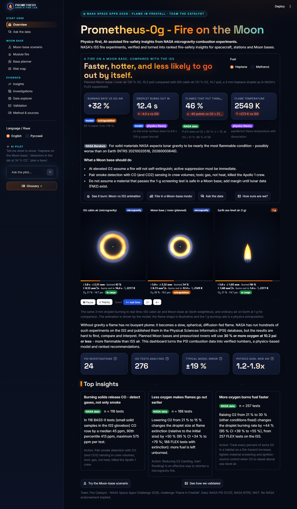
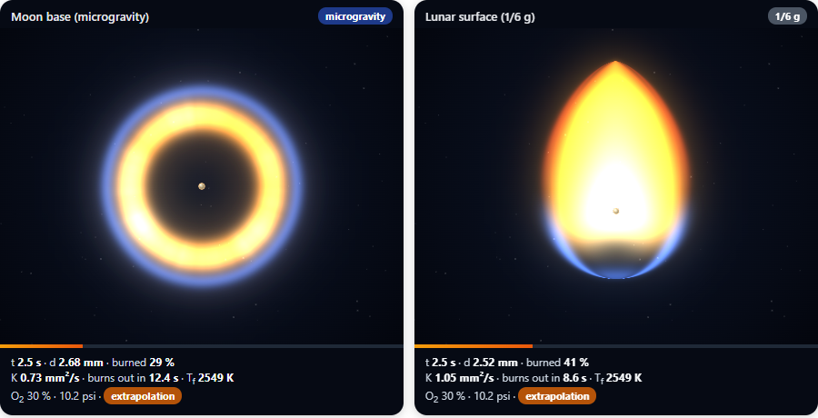
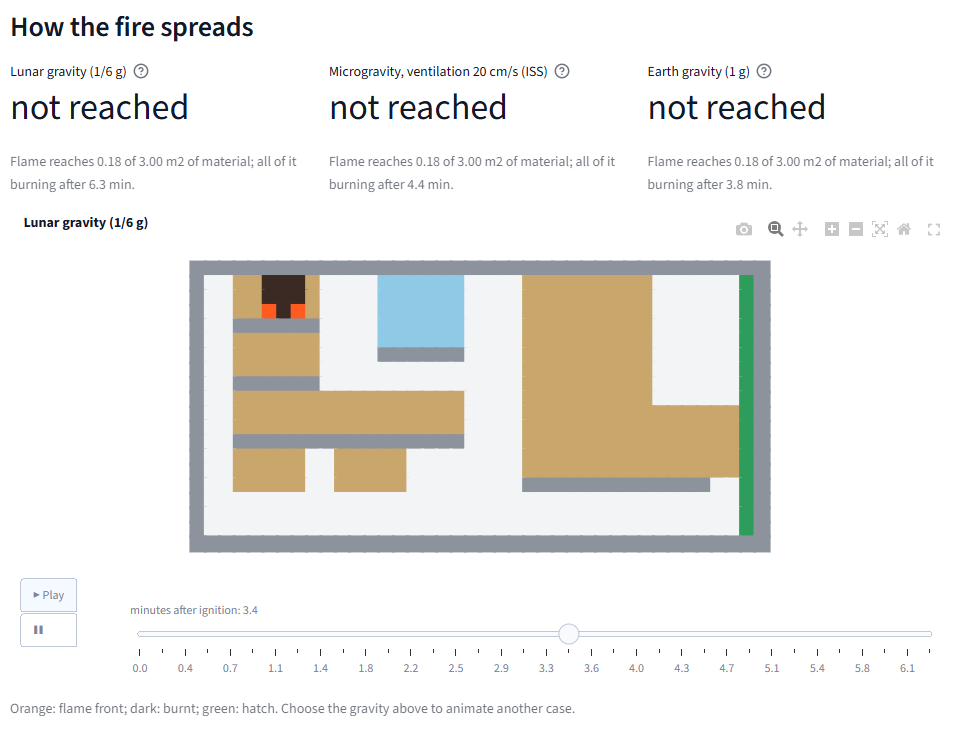
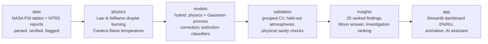

# Prometheus-0g - Fire on the Moon

## ▶ Live app: [prometheus-0g.streamlit.app](https://prometheus-0g.streamlit.app/)

Open it in any browser, also on a phone (Russian: [?lang=ru](https://prometheus-0g.streamlit.app/?lang=ru)). If the page
says *"This app has gone to sleep"*, click **"Yes, get this app back up!"** and wait a moment - free hosting sleeps
after 12 hours without visitors; a scheduled check ([keep-awake](.github/workflows/keep-awake.yml)) visits it every 4 hours.

**Physics-first, AI-assisted fire-safety insights from NASA microgravity combustion experiments.**
NASA Space Apps Challenge 2026 - challenge *Flame in Freefall: AI-Powered Fire Safety Insights from Microgravity
Combustion Data*. Team **The Catalyst** (Ruslan Sharafutdinov), Uralsk, Kazakhstan.

| | |
|---|---|
| **Live dashboard** | https://prometheus-0g.streamlit.app/ (English; Russian: https://prometheus-0g.streamlit.app/?lang=ru) |
| **Demo (7 slides)** | [docs/demo/prometheus-0g_slides.pdf](docs/demo/prometheus-0g_slides.pdf) (English; numbers and screenshots from the live app) |
| **Source and data** | https://github.com/ruska51/prometheus-0g - code Apache-2.0, NASA data CC0 / public domain |



## The problem

Without gravity a flame has no buoyant plume: it becomes a slow, spherical, diffusion-fed flame that behaves differently
from the flames fire-safety rules were written for. NASA has run hundreds of such experiments on the International
Space Station and published them in the Physical Sciences Informatics (PSI) repository, but the results are scattered
across 24 investigations and are hard to find, compare and interpret.

Spacecraft fires are rare but unforgiving. In **Apollo 1** (1967) "because of the pure oxygen atmosphere, the fire spread
quickly" and the crew died of "asphyxia from carbon monoxide and other toxic gases" (NASA SMA). In **Apollo 13** (1970)
heaters in an oxygen tank overheated, "degrading the Teflon insulation" - oxygen hardware plus electrical heat. On
**Mir** (1997) an oxygen generator burned, "the flame blocked the evacuation route to the Soyuz spacecraft" and smoke
was cleared "over several hours" (NASA History).

The next habitats raise the stakes: according to the challenge, a planned **Moon base or pressurized rover will breathe
30 % oxygen or more at 10.2 psi or less**, a richer atmosphere than ISS air (21 % O2, 14.7 psi), and at lunar gravity.
**Will a fire there burn faster and hotter, and will it go out by itself?** This project answers that question with
NASA data.

## Our solution

A public, bilingual web dashboard that turns the PSI combustion data into verified numbers, a physics-based model and
ranked recommendations - for cabin-materials engineers, crew-safety planners and combustion researchers.

- **Headline answer:** "Fire on the Moon: faster, hotter, and less likely to go out by itself", with
  every number computed live and labelled by type of evidence.
- **Moon-base scenario:** choose an atmosphere (ISS, Moon base, spacesuit or custom O2 / pressure / diluent / droplet
  size) and get the burning rate from physics and from the hybrid model with a 95 % band, flame temperature, chance of
  self-extinction, the Earth and lunar-surface factors, a reliability label (in range / extrapolation / unreliable)
  and the nearest real NASA tests.
- **See it burn:** an animation of the same droplet in two atmospheres (for example microgravity vs the lunar surface);
  droplet shrinkage, burn time, extinction and flame temperature come from the model.
- **Fire in a Moon-base module:** draw a module wall (fabric, acrylic, metal, hatch), set the ignition point and
  watch the flame spread at the rates NASA measured for those materials in microgravity (Saffire), at lunar gravity
  (LUCI sounding rocket) and on Earth; time until the flame reaches the hatch in all three, what NASA has found about
  solids at lunar gravity (quoted), and a 7-item fire-safety checklist with the evidence for each item.
- **20 ranked insights** for prevention, detection and suppression, plus lessons from Apollo 1, Apollo 13 and Mir and
  benefits on Earth (NASA spinoffs).
- **All 24 PSI combustion investigations** ranked by relevance to crew fire safety, with a comparison matrix of what
  each data table records and which investigations share hardware.
- **Ask the data:** an AI assistant that answers only from our verified results and public NASA technical reports,
  cites a source after every statement, and says so when the data do not cover a question.
- **Honest validation page** and a data explorer with every raw NASA row downloadable.





## Key insights (Moon-base set)

| # | Insight | Number | Evidence |
|---|---|---|---|
| P2 | A Moon-base atmosphere burns droplets faster than ISS air | **+32 %** burning rate for a 3 mm droplet (95 % band -2 % to +77 %), methanol and heptane; labelled *extrapolation* (30 % O2 was tested only from 0.703 atm) | model (hybrid, 274 FLEX tests) |
| S4 | At 30 % O2 droplet flames put themselves out less often | the flame burned the droplet out without extinguishing in **54 % of 13** N2 tests at O2 >= 30 %, vs **14 % of 58** at O2 <= 21 % | NASA data (FLEX) |
| P1 | More oxygen burns fuel faster | O2 21 % -> 30 % changes the burning rate by **+44 %** (95 % CI +39 % to +55 %), 257 FLEX tests | NASA data (FLEX) |
| D1 | Burning solids release CO - detect gases, not only smoke | CO rose by a median **45 ppm**, 90th percentile 413 ppm, maximum 575 ppm per test, 118 BASS-II tests | NASA data (BASS-II) |
| P6 | For solid materials, lunar gravity may be the most flammable condition | NASA Glenn: "Lunar gravity is nearly the most flammable condition"; a partial-g habitat fire is expected to be "substantially worse than in 0-g and potentially worse than even 1-g" | NASA literature (NTRS 20210020516, 20260000646) |

What a Moon base should do: assume a fire at elevated O2 will not self-extinguish and suppress immediately; pair smoke
detection with CO sensing; do not treat 1-g material screening as proof of safety at lunar gravity. All 20 insights
with sources: [docs/INSIGHTS.md](docs/INSIGHTS.md).

## How it works



- **data** (`src/fif/data`): parsers for the PSI Experimental Tables, a schema, cleaning with quality flags (anomalies
  are flagged, never silently fixed), a registry of every raw file with sha256 (`data/catalog.yaml`).
- **physics** (`src/fif/physics`): quasi-steady droplet combustion with the Law & Williams (1972) property
  prescription, NIST and NASA property data, equilibrium flame temperature with dissociation (Cantera, NASA Glenn
  thermodynamic data), buoyancy correction for Earth and the Moon.
- **models** (`src/fif/models`): hybrid burning-rate model `ln K = ln K_theory + ln c_fuel + GP(conditions)` with a 95 %
  band, and extinction classifiers; only conditions known before ignition are features (a test fails on any leakage).
- **validation** (`src/fif/validation`): repeated cross-validation grouped by test regime, leave-a-class-out
  extrapolation, sensitivity of the extinction label, reliability labels.
- **insights** (`src/fif/insights`): every number computed live from data or models, ranked by
  `S = w_evidence x ln(1 + n_tests) x (0.3 + 0.7 e)`.
- **app** (`app/`): pages only call the package; there is no physics in the page code. Details:
  [docs/ARCHITECTURE.md](docs/ARCHITECTURE.md).

## Physics

Burning-rate constant of a droplet (d^2-law, `d(t)^2 = d0^2 - K t`), Law & Williams (1972) Eq. 1 with their property
prescription:

    K = 8 lambda_1 / (rho_F c_1) * ln(1 + B),   B = [Y_O q / i - c_1 (T_b - T_inf)] / L

`c_1` = heat capacity of the fuel vapour, `lambda_1 = 0.4 lambda_fuel + 0.6 lambda_air` at `(T_b + T_f)/2`, `q` = lower
heating value, `T_f` = equilibrium flame temperature with dissociation. Gravity: `K_g = K (1 + 0.533 Gr^0.52)` with
`Gr` proportional to g (Earth 1 g: extrapolated; lunar surface 1/6 g: inside the fitted range for a 3 mm droplet).
Flame-to-droplet size ratio `ln(1+B) / ln(1 + Y_O/nu)` (quasi-steady theory, known to overestimate measured flames
several-fold). Full derivation, data sources and limits: [docs/PHYSICS.md](docs/PHYSICS.md).

## Data

| NASA data | What | Used for |
|---|---|---|
| PSI-69 **FLEX** (ISS droplet combustion) | 276 tests (274 PSI rows + 2 recovered from the NASA report), methanol and n-heptane, O2 0.12-0.34, 0.69-3.05 atm, N2 / CO2 / He, droplets 1.1-4.7 mm | models and insights; every cell cross-checked against NASA/TP-2015-216046: **3288 cells, 0 differences** |
| PSI-159 **ACME CFI-G** (gaseous flames) | 333 tests | ignition and self-extinction insights |
| PSI-25 **BASS-II** (burning solids) | 129 tests (118 usable for CO) | CO insight |
| PSI-101 **SAME-R** (smoke) | 109 tests, 5 materials | detection insight |
| All 24 PSI Combustion Science investigations | records and data tables | catalog, ranking, comparison matrix |
| 12 public-use NASA NTRS reports | FLEX, BASS-II, ACME, SAME, Saffire, lunar flammability | physics checks, the assistant's report search |

All raw files are in `data/raw/` with sha256 in `data/catalog.yaml` (the 43 MB FLEX report is fetched on demand by
`scripts/verify_flex_vs_tp.py`; NTRS texts by `scripts/fetch_ntrs_corpus.py`). To get them yourself: PSI investigation
pages at https://psi.nasa.gov (Experimental Tables), reports at https://ntrs.nasa.gov. Provenance, licenses and the
data dictionary: [docs/DATA_SOURCES.md](docs/DATA_SOURCES.md), [docs/DATA_DICTIONARY.md](docs/DATA_DICTIONARY.md),
[docs/DATA_QUALITY.md](docs/DATA_QUALITY.md).

## Validation

Repeated GroupKFold (5 folds by test regime, 5 seeds), burning-rate constant K, 258 tests in 78 regimes:

| Model | RMSE ln K | MAE, mm2/s | 95 % coverage |
|---|---|---|---|
| mean | 0.305 | 0.109 | 0.94 |
| physics only | 0.301 | 0.113 | 0.87 |
| pure machine learning (GP) | 0.174 | 0.046 | 0.92 |
| **hybrid (physics + GP)** | **0.171** | **0.045** | 0.92 |

Extrapolation - a whole class of atmospheres left out of training (RMSE ln K, physics / pure ML / hybrid): helium
0.298 / 0.278 / **0.148**; CO2 0.335 / 0.258 / **0.224**; ~0.7 atm 0.350 / 0.264 / **0.223**; O2 >= 0.30
(Moon-like) 0.177 / 0.197 / **0.154**. Inside the tested conditions the hybrid equals pure ML; **on atmospheres it
never saw, the physics makes it 1.2-1.9x more accurate** - the Moon-base case. Extinction classifier (interface model):
AUC 0.79. Where it fails, honestly: no model transfers to a fuel it has not seen; above 1.2 atm physics alone is best;
the extinction classifier is weak on held-out atmospheres. Full report: [docs/VALIDATION.md](docs/VALIDATION.md),
[docs/MODEL_CARD.md](docs/MODEL_CARD.md); assistant evaluation: [docs/ASSISTANT_EVAL.md](docs/ASSISTANT_EVAL.md).

## How to run

Tested from a fresh clone on Windows 11 with Python 3.12; the same commands work on macOS / Linux (`python3`).
Dependencies are pinned in `requirements.txt`.

```
git clone https://github.com/ruska51/prometheus-0g
cd prometheus-0g
python run.py setup   # .venv + pinned requirements + the fif package (about 1 min)
python run.py all     # verify raw-data hashes -> build data -> train models -> build insights -> tests (about 2 min)
python run.py app     # dashboard at http://localhost:8501
```

Single steps: `python run.py verify | data | train | validate | insights | test | lint | app`. The AI assistant
needs a free Google Gemini key in the environment (`GEMINI_API_KEY`); everything else works without it.

## Project structure

```
app/                Streamlit dashboard: main.py, views/ (9 pages), flame animation, EN/RU texts
src/fif/
  data/             parsers, schema, cleaning, raw-file registry
  physics/          droplet burning (Law & Williams), properties, mixing rules, flame temperature
  models/           hybrid K model, extinction classifiers, feature guard against leakage
  validation/       grouped CV, extrapolation, reliability labels, label sensitivity
  insights/         insight catalog and ranking, Moon answer, scenario, flame inputs, comparison matrix
  assistant/        retrieval over results + NASA reports, Gemini call, citation checks
data/raw/           NASA files as downloaded (sha256 in data/catalog.yaml)
data/processed/     clean tables used by models and app
models/             trained models (joblib)
scripts/            reproducible steps (build, train, validate, insights, screenshots)
tests/              165 tests: data, physics, models, validation, insights, app (EN/RU), assistant
docs/               PHYSICS, MODEL_CARD, VALIDATION, INSIGHTS, DECISIONS (ADR log), WORKLOG, SUBMISSION, ...
```

## Limitations and future work

- Quantitative models cover two fuels (methanol, n-heptane) from one experiment at ISS ambient temperature; solids are
  covered through CO measurements, NASA literature and the module sketch, which uses flame-spread rates measured on thin
  fabric and acrylic samples in air (the PSI tables hold no flame-spread rates); it is not a fire simulation.
- PSI has no partial-gravity data: lunar numbers are physics bounds, and the Moon-base atmosphere is labelled
  extrapolation (just below the tested pressure for 30 % O2).
- The flame animation's size uses quasi-steady theory (it overestimates measured flames) and its shape is illustrative.
- The AI assistant can attach a real number to a wrong label; the cited excerpts are shown under each answer.
- Next: spread rates in Moon-base air (30 % O2), Mars gravity, the FM2 lunar results when published.

## Use of AI

The analysis, code and texts were produced with Claude Code (Anthropic) under the direction of the team member, who
made every scientific and design decision (logged in [docs/DECISIONS.md](docs/DECISIONS.md)). Inside the product the
only AI component is the optional "Ask the data" assistant (Google Gemini), restricted to our results and NASA reports,
with checked citations. All other numbers come from deterministic code. No AI-generated images; the demo slides
use screenshots of the app. Details: [docs/AI_USAGE.md](docs/AI_USAGE.md).

## Sources

Official challenge resources: R1 [NASA Physical Sciences Informatics](https://psi.nasa.gov/physci/repo/search?q=combustion)
(all quantitative data); R2 [Apollo 1, NASA SMA](https://sma.nasa.gov/sma-disciplines/accllp/apollo-1);
R3 [Apollo 13, NASA SMA](https://sma.nasa.gov/sma-disciplines/accllp/apollo-13);
R4 [Fire aboard Mir, NASA History](https://www.nasa.gov/history/25-years-ago-fire-aboard-space-station-mir/);
R5 [Fireman's Air Tanks, NASA Spinoff](https://spinoff.nasa.gov/node/9582);
R6 [Fire Detector, NASA Spinoff](https://spinoff.nasa.gov/node/9407);
R7 [Fire Attire, NASA Spinoff](https://spinoff.nasa.gov/node/9918).
Also: NASA/TP-2015-216046 (FLEX detailed results) and other NASA NTRS reports, NIST Chemistry WebBook, NASA TR R-132
(Svehla), NASA RP-1311 and TM-4513, Law & Williams, Combust. Flame 19 (1972) 393-405, Cantera, NASA Glenn photo
C-1998-485 (visual reference only). Full list with licenses: [docs/DATA_SOURCES.md](docs/DATA_SOURCES.md).

## Team and license

**The Catalyst** - Ruslan Sharafutdinov, chemical-technology student, Uralsk, Kazakhstan.
Code: Apache-2.0 ([LICENSE](LICENSE)). NASA data: CC0 / public domain. No NASA endorsement implied; no NASA logos are
used.
