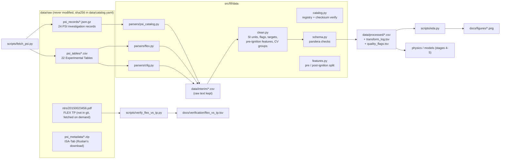
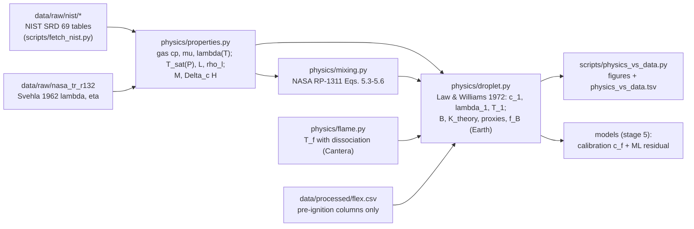
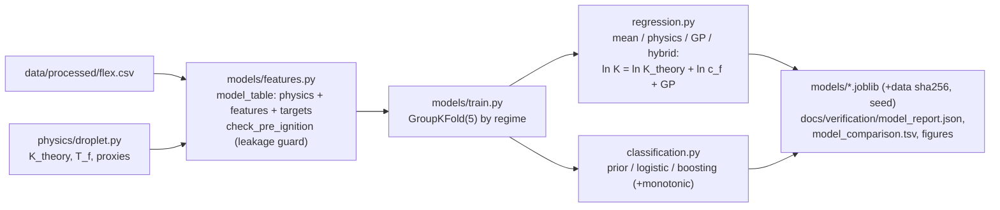

# Architecture

Layers are independent: `data -> physics -> models -> validation -> insights -> app` (CLAUDE.md section 5). The app never computes physics itself; it calls the `fif` package.

## Data layer (stage 3)



| Module | Purpose | Inputs -> outputs |
|---|---|---|
| `fif.data.catalog` | read `data/catalog.yaml`, resolve raw paths, verify sha256 | YAML -> dicts |
| `fif.data.parsers.flex` | PSI-69 CSV -> interim, raw cell text kept | CSV -> DataFrame (274 rows) |
| `fif.data.parsers.cfig` | PSI-159 normal + inverse CSVs -> interim | 2 CSV -> DataFrame (333 rows) |
| `fif.data.parsers.psi_catalog` | 24 PSI records -> investigation catalog | JSON -> DataFrame (24 rows) |
| `fif.data.clean` | units to SI, quality flags, targets, derived pre-ignition features, CV groups; every step logged | interim -> processed |
| `fif.data.schema` | pandera schemas: types, physical bounds, flag consistency | processed -> validated |
| `fif.data.features` | lists of pre-ignition features vs post-ignition columns (leakage guard) | - |
| `fif.data.build` | the pipeline; tests pass a temporary output dir | raw -> interim + processed |

Commands (repository root):

```
.venv/Scripts/python scripts/fetch_psi.py         # re-download PSI records + tables (network)
.venv/Scripts/python scripts/build_data.py        # raw -> interim -> processed
.venv/Scripts/python scripts/verify_flex_vs_tp.py # FLEX CSV vs NASA/TP Table IX (downloads the PDF once)
.venv/Scripts/python scripts/eda.py               # figures in docs/figures
.venv/Scripts/python -m pytest -q
```

Every processed row carries provenance: `source_id`, `source_file`, `row_id`, `quality_flag`.

## Physics layer (stage 4)



| Module | Purpose | Inputs -> outputs |
|---|---|---|
| `fif.physics.properties` | read NIST raw tables; interpolation; molar masses, heats of combustion | raw files -> arrays (SI) |
| `fif.physics.mixing` | mole/mass fractions, mixture viscosity, conductivity, cp | x (rows x species), T -> arrays |
| `fif.physics.flame` | stoichiometric adiabatic flame temperature with dissociation (Cantera HP equilibrium, NASA Glenn thermo) | fuel, T_b, x, T_inf, p -> T_f |
| `fif.physics.droplet` | burning-rate constant with the Law & Williams (1972) prescription, extinction proxies, L&W buoyancy correction; `evaluate_flex(df)` | fuel, p, x, d0 -> DataFrame |

## Models layer (stage 5)



| Module | Purpose |
|---|---|
| `fif.models.features` | feature sets (raw + physics), allow-list, `check_pre_ignition`, `model_table` |
| `fif.models.regression` | `MeanModel`, `PhysicsModel`, `GPModel`, `HybridKModel` (predict mean and sigma in log space) |
| `fif.models.classification` | `PriorModel`, `logistic()`, `boosting(features, monotonic)` |
| `fif.models.train` | grouped CV comparison, interpretation (permutation importance, partial dependence, coefficient sign check), final fit and save |

Command: `.venv/Scripts/python scripts/train_models.py` (~45 s). Details: docs/MODEL_CARD.md.

## Validation, insights, app

_Stages 6-8._
